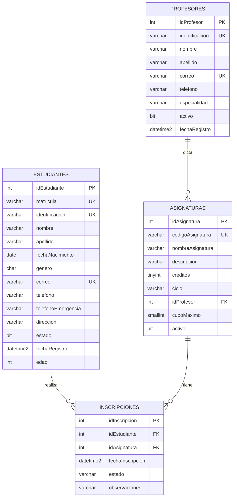

# Documentación del Proyecto

## Portada editable

Institución: ________________________________

Asignatura: ________________________________

Profesor: ________________________________

Fecha: ________________________________

Integrantes:
- ________________________________
- ________________________________
- ________________________________
- ________________________________

## 1. Introducción

Este proyecto tiene como objetivo diseñar y desarrollar un sistema de gestión para una institución educativa. El sistema permite administrar estudiantes, profesores, asignaturas e inscripciones en una estructura relacional clara, ordenada y verificable.

El trabajo se realiza con enfoque académico, en un nivel inicial de estudio de bases de datos. La intención es comprender cómo se modelan las entidades, cómo se relacionan entre sí, y cómo se implementan estas relaciones dentro de Microsoft SQL Server usando T-SQL.

## 2. Objetivo general

Diseñar e implementar una base de datos relacional para una institución educativa, además de una interfaz administrativa básica que permita visualizar y operar la información de forma clara y profesional.

## 3. Objetivos específicos

- Crear una base de datos con esquema propio.
- Diseñar tablas para estudiantes, profesores, asignaturas e inscripciones.
- Definir claves primarias, foráneas, restricciones y reglas de integridad.
- Aplicar principios de normalización básicos.
- Incluir una columna calculada y un ejemplo de columna SPARSE.
- Crear datos de prueba para validar el modelo.
- Documentar el proceso y preparar la presentación académica.

## 4. Descripción del problema

Una institución educativa necesita controlar información académica de forma ordenada y segura. Si la información se almacena sin diseño previo, se pueden producir errores como:

- duplicación de estudiantes o profesores
- matrículas repetidas
- inscripciones sin control
- asignaturas sin responsable académico
- inconsistencias entre registros

Por eso se requiere un modelo relacional con restricciones y validaciones que permitan mantener integridad y consistencia.

## 5. Requisitos del sistema

El sistema debe:
- registrar estudiantes
- registrar profesores
- registrar asignaturas
- inscribir estudiantes en asignaturas
- consultar y buscar registros
- evitar duplicados
- respetar integridad referencial
- permitir pruebas de inserción, actualización y eliminación controlada

## 6. Análisis de entidades

### Estudiante
Representa a cada alumno de la institución. Tiene datos personales, académicos y de contacto.

### Profesor
Representa a cada docente que imparte asignaturas.

### Asignatura
Representa cada materia del plan académico, con su información básica y responsable docente.

### Inscripción
Representa la relación entre un estudiante y una asignatura, además del estado y la fecha.

## 7. Diccionario de datos

### Tabla: academico.estudiantes
| Columna | Tipo | Descripción |
|---|---|---|
| idEstudiante | int identity | Identificador único del estudiante |
| matricula | varchar(20) | Matrícula única del estudiante |
| identificacion | varchar(20) | Documento de identidad |
| nombre | varchar(100) | Nombre |
| apellido | varchar(100) | Apellido |
| fechaNacimiento | date | Fecha de nacimiento |
| genero | char(1) | Género |
| correo | varchar(150) | Correo electrónico |
| telefono | varchar(15) | Teléfono principal |
| telefonoEmergencia | varchar(15) SPARSE | Teléfono de emergencia |
| direccion | varchar(200) | Dirección |
| estado | bit | Estado activo/inactivo |
| fechaRegistro | datetime2 | Fecha de alta |
| edad | AS DATEDIFF(year, fechaNacimiento, GETDATE()) | Columna calculada |

### Tabla: academico.profesores
| Columna | Tipo | Descripción |
|---|---|---|
| idProfesor | int identity | Identificador único |
| identificacion | varchar(20) | Documento de identidad |
| nombre | varchar(100) | Nombre |
| apellido | varchar(100) | Apellido |
| correo | varchar(150) | Correo institucional |
| telefono | varchar(15) | Teléfono |
| especialidad | varchar(100) | Especialidad del docente |
| activo | bit | Estado activo |
| fechaRegistro | datetime2 | Fecha de registro |

### Tabla: academico.asignaturas
| Columna | Tipo | Descripción |
|---|---|---|
| idAsignatura | int identity | Identificador único |
| codigoAsignatura | varchar(20) | Código único |
| nombreAsignatura | varchar(100) | Nombre de la asignatura |
| descripcion | varchar(250) | Descripción de la materia |
| creditos | tinyint | Cantidad de créditos |
| ciclo | varchar(30) | Semestre o ciclo |
| idProfesor | int | Profesor responsable |
| cupoMaximo | smallint | Máximo de estudiantes |
| activo | bit | Estado activo |

### Tabla: academico.inscripciones
| Columna | Tipo | Descripción |
|---|---|---|
| idInscripcion | int identity | Identificador único |
| idEstudiante | int | Estudiante inscrito |
| idAsignatura | int | Asignatura asignada |
| fechaInscripcion | datetime2 | Fecha de inscripción |
| estado | varchar(15) | Estado de la inscripción |
| observaciones | varchar(200) | Observaciones |

## 8. Diagrama entidad-relación



## 9. Explicación de las relaciones

- Un estudiante puede tener muchas inscripciones.
- Una asignatura puede tener muchas inscripciones.
- Cada inscripción pertenece a un estudiante y una asignatura.
- Un profesor puede impartir muchas asignaturas.
- Una asignatura puede tener un profesor responsable, o ser nula si el modelo lo permite.

Esto genera una relación de uno a muchos y muchos a muchos entre estudiantes y asignaturas a través de la tabla `inscripciones`.

## 10. Justificación de decisiones de diseño

Se decidió separar la información en tablas específicas para evitar redundancia. Por ejemplo, los datos personales del estudiante no se mezclan con la información de inscripción. Esto ayuda a mantener la integridad y facilita la consulta.

Se usaron nombres consistentes en español, siguiendo una convención simple:
- tabla: `estudiantes`, `profesores`, `asignaturas`, `inscripciones`
- columnas: `idEstudiante`, `idProfesor`, `idAsignatura`, etc.
- claves: `PK_...`, `FK_...`, `UQ_...` cuando se usan nombres explícitos

## 11. Normalización aplicada

Se aplicó una normalización inicial de primer y segundo nivel:
- cada entidad tiene su propia tabla
- no se repiten datos de estudiantes en inscripciones
- no se repiten datos de profesores en asignaturas
- cada relación se maneja mediante claves foráneas

Esto evita inconsistencias y facilita la actualización de registros.

## 12. Columna calculada

Se incluye la columna:

```sql
edad AS (DATEDIFF(year, fechaNacimiento, GETDATE()))
```

Tiene sentido porque la edad puede calcularse a partir de la fecha de nacimiento del estudiante sin almacenar un valor redundante. De esta manera, el dato siempre se actualiza automáticamente según la fecha actual.

## 13. Columna SPARSE

Se utiliza una columna `SPARSE` en `estudiantes.telefonoEmergencia` para optimizar el almacenamiento cuando muchos estudiantes no tengan teléfono de emergencia registrado.

Ejemplo:

```sql
telefonoEmergencia varchar(15) NULL SPARSE
```

Ventajas:
- reduce espacio cuando hay muchos valores NULL
- útil para columnas opcionales con baja densidad de datos

Limitaciones:
- no se usa en todas las columnas
- puede complicar la administración si se usa sin necesidad
- no es apropiado para columnas que contienen muchos valores no nulos

## 14. Procedimiento de creación en SSMS

1. Abrir SSMS.
2. Conectarse a la instancia de SQL Server.
3. Abrir el archivo `sql/01_creacion_bd.sql`.
4. Ejecutar el script completo.
5. Verificar que la base de datos se crea correctamente.
6. Ejecutar `sql/02_datos_prueba.sql`.
7. Validar con `sql/03_consultas_verificacion.sql`.

## 15. Evidencias y capturas de pantalla

Para la presentación universitaria:
- mostrar el diagrama ER
- mostrar la estructura de tablas
- documentar el script ejecutado
- incluir resultados de consultas SELECT
- tomar capturas de SSMS mostrando las tablas creadas
- mostrar el resultado de inserciones y validaciones

## 16. Casos de prueba y resultados esperados

### Caso 1: matrícula duplicada
Se intenta insertar dos estudiantes con la misma matrícula. Debe fallar por la restricción UNIQUE.

### Caso 2: inscripción duplicada
Se intenta inscribir al mismo estudiante en la misma asignatura dos veces. Debe fallar por la restricción que impide duplicados.

### Caso 3: actualización controlada
Se actualiza un correo o un teléfono y se verifica que no se repita.

### Caso 4: eliminación con integridad referencial
Se intenta eliminar un profesor que tiene asignaturas asignadas. Debe advertir la dependencia de la clave foránea.

## 17. Conclusión

El proyecto permite comprender cómo se construye un sistema de gestión académico con base de datos relacional. Se abordan conceptos fundamentales de bases de datos como esquema, tablas, relaciones, restricciones, integridad referencial, columnas calculadas y columnas SPARSE.

También se presenta una interfaz visual para facilitar la comprensión del sistema y se preparan datos de prueba para validar el funcionamiento.
